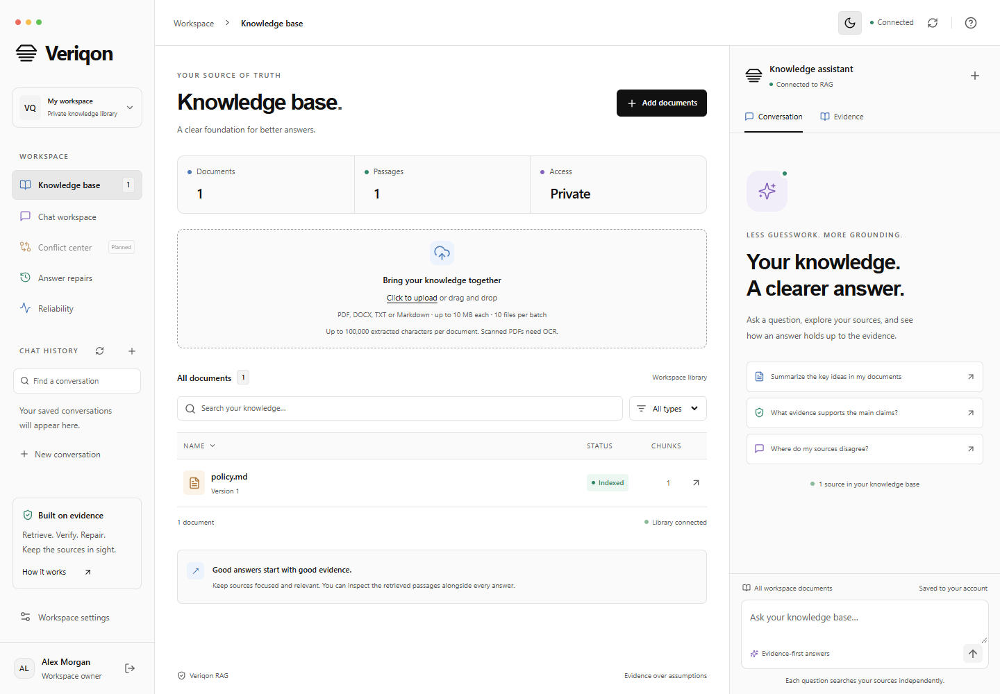
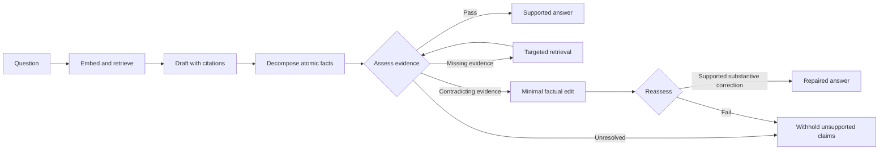
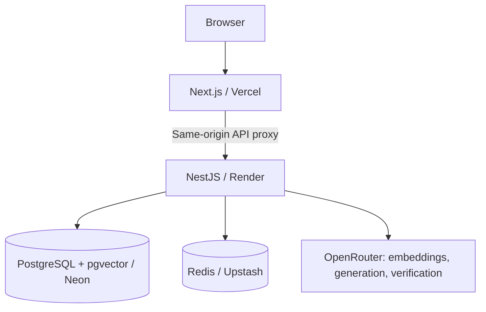

<div align="center">

# Veriqon

**Better answers. Built on your sources.**

A document research workspace that retrieves evidence, checks each claim, and repairs unsupported answers before showing them to you.

[](https://github.com/iamrakiib/veriqon/actions/workflows/ci.yml)


[Open Veriqon](https://veriqon-two.vercel.app) · [Deployment](DEPLOYMENT.md) · [API examples](POSTMAN_TESTS.md) · [Security](SECURITY.md)

<picture>
  <source media="(prefers-color-scheme: dark)" srcset="docs/screenshots/workspace-desktop.png">
  
</picture>

</div>

## Research with the evidence in view

Upload a paper, ask how it works, and inspect the passages behind the answer. Veriqon keeps documents, citations, chat history and answer repairs together in a responsive monochrome interface with dark, light and system themes.

- **A private library for every account:** PDF, DOCX, TXT and Markdown ingestion, search, source previews, original-file downloads and persistent conversations.
- **Account recovery:** save single-use recovery codes from Settings; a password reset revokes existing sessions.
- **An inspection trail:** hybrid retrieval expands neighboring passages; structured claim assessments include exact quotes. Missing evidence triggers targeted retrieval. Minimal factual edits require final verification and a substantive-change check.
- **Honest failure states:** missing evidence, provider quotas, interrupted answers, upload errors and stale historical sources are surfaced explicitly.
- **A deployable stack:** Next.js, NestJS, PostgreSQL/pgvector, Redis limits and work leases, Docker, migrations and automated checks.
- **Desktop and mobile:** independently scrolling panels, a visible composer, keyboard-accessible dialogs and mobile navigation.

[Mobile workspace](docs/screenshots/workspace-mobile.png) · [Mobile assistant](docs/screenshots/assistant-mobile-dark.png) · [Account screen](docs/screenshots/auth-desktop-dark.png)

Screenshots use synthetic fixtures. The live app is an early public release with account registration; accounts do not share their libraries. Free hosting may take about a minute to wake, and AI calls share the operator's provider quota.

## How an answer is built



The verifier is a model assessment, **not a guarantee of truth**. Questions are independent: previous turns are saved but are not supplied as model context. Retrieval can miss information that a document contains; abstention is not proof that the entire document lacks an answer.

## Architecture



PostgreSQL stores accounts, session hashes, documents and original bytes, vectors, conversations and answers. Redis coordinates disposable rate limits and active-work leases. PostgreSQL performs **exact** vector ranking; there is no ANN index yet. Bounded local caches use account and document-revision keys. SQLite is an optional development mode, not the cloud database.

```text
apps/web/          Next.js interface and API proxy
src/auth/          Password hashing, JWT sessions and guards
src/database/      PostgreSQL/SQLite storage and migrations
src/vector-store/  Embeddings, passage windows and retrieval
src/rag/           Uploads, generation, verification and repair
src/common/        Provider handling, limits and configuration
src/tests/         Backend and infrastructure tests
tests/browser/     Desktop/mobile interaction tests
scripts/           Migrations, bootstrap and evaluation tools
```

## Start with Docker

Requirements: Docker with Linux containers, Node.js 22.18+ for the setup helper, and an OpenRouter account with available embedding/chat models.

```sh
git clone https://github.com/iamrakiib/veriqon.git
cd veriqon
node scripts/init-docker.mjs
```

Fill `OPENROUTER_API_KEY`, `EMBEDDING_MODEL` and `LLM_MODEL` in the generated private `.env.docker`. Optionally set `VERIFIER_MODEL`; otherwise verification uses the generation model. The helper generates separate database, JWT and setup secrets without overwriting existing settings.

```sh
docker compose --env-file .env.docker up --build -d
```

Open **http://localhost:3002**. Create the first owner using `SETUP_CODE` from `.env.docker`. Each installation has its own database and credentials. New Docker installations default to closed registration after owner setup; set `ALLOW_REGISTRATION=true` to offer public sign-up. Never commit the generated file.

See [DEPLOYMENT.md](DEPLOYMENT.md) for cloud deployment, TLS, migration, backups, hosting limits and releases.

<details>
<summary>Run without Docker for local development</summary>

Run `npm ci`, copy `.env.example` to `.env`, and configure the provider and a random `JWT_SECRET` of at least 32 characters. Generate a secret locally:

```sh
node -e "console.log(require('crypto').randomBytes(48).toString('base64url'))"
```

Leave `DATABASE_URL` and `REDIS_URL` blank for SQLite development. Start these commands in separate terminals:

```sh
npm run start:dev
npm run web:dev
```

Open **http://127.0.0.1:3001**. The first-owner code is generated in `data/setup-code.txt`. No default password exists. Local data under ignored `data/` does not synchronize with the cloud. If the API port changes, set server-side `API_ORIGIN` in `apps/web/.env.local` and restart the frontend.

</details>

## Verification

```sh
npm ci
npm run lint
npm test
npm run web:build
npm run web:check
npm run test:browser
npm audit --audit-level=high
```

Backend tests start real HTTP servers with deterministic provider stubs. Browser tests use synthetic network fixtures to verify desktop/mobile forms, uploads, citations, repairs, sessions, themes and viewport fit. Local tests use Edge; CI installs Chromium. These suites do not consume provider credits.

For real PostgreSQL and Redis checks, use the **separate disposable test stack**:

```sh
docker compose -f compose.test.yaml up -d --wait
npm run test:infra
docker compose -f compose.test.yaml down
```

CI also builds both Docker images. See the [current engineering review](docs/release-review-2026-10-29.md). `npm run evaluate` makes real provider requests using a dedicated test account; it is a smoke tool, not an independently labeled benchmark.

## Security and limits

Passwords use salted scrypt. Access JWTs expire after 15 minutes; hashed rotating refresh tokens support sessions up to seven days. Cookies are HttpOnly, SameSite=Lax and Secure in cloud production. Logout revokes the database session. Writes validate origins and a required request header; data access is scoped to the signed-in account.

Uploads allow 10 MB and 100,000 extracted characters per file, ten files per browser batch, and 100 documents / 100 MB of source files plus text per account. Scanned PDFs need OCR. Parsing has a process boundary, memory limit and deadline. AI work is rate-limited and bounded in concurrency.

Email addresses are **not verified**. Recovery codes are available: sign in, open Settings, confirm your password and save eight one-time codes. Use **Forgot password?** with your email and one saved code to reset your password and revoke existing sessions. New accounts receive codes at registration. Replacing codes invalidates the old set; there is no email reset delivery. MFA, invitations, account deletion/export and security event monitoring are not implemented. AI providers receive document text or retrieved passages. Review provider handling before uploading confidential data. See [SECURITY.md](SECURITY.md).

## Research roadmap

This is a foundation for the TemporalGuard research direction. **Not implemented:** immutable document versions, effective-date retrieval, authority-based conflict resolution, continuous answer revalidation, durable ingestion workers, learned reranking and independent retrieval/faithfulness benchmarks. The Conflict Center displays unresolved evidence from saved answer assessments; it does not perform a library-wide scan or resolve authority disputes.

Reliability views show observed outcomes, not factual accuracy or an SLA. Historical audits in `docs/` describe earlier stages; the current review and deployment guide take precedence.

## Contributing

See [CONTRIBUTING.md](CONTRIBUTING.md). Reproducible bug reports and focused changes are welcome. Keep documents, database exports, credentials and account details out of public issues and commits.

See the [reliability audit](docs/reliability-audit.md) for actual failure causes, verification boundaries and test results. Citation numbers such as `[1]`, `[2]` and `[3]` identify retrieved passages, which can all belong to the same document.

The [RAC-inspired method and comparison](docs/rac-method.md) documents the paper/code audit, differences from RAC, reproducible evaluation and measured limitations.
