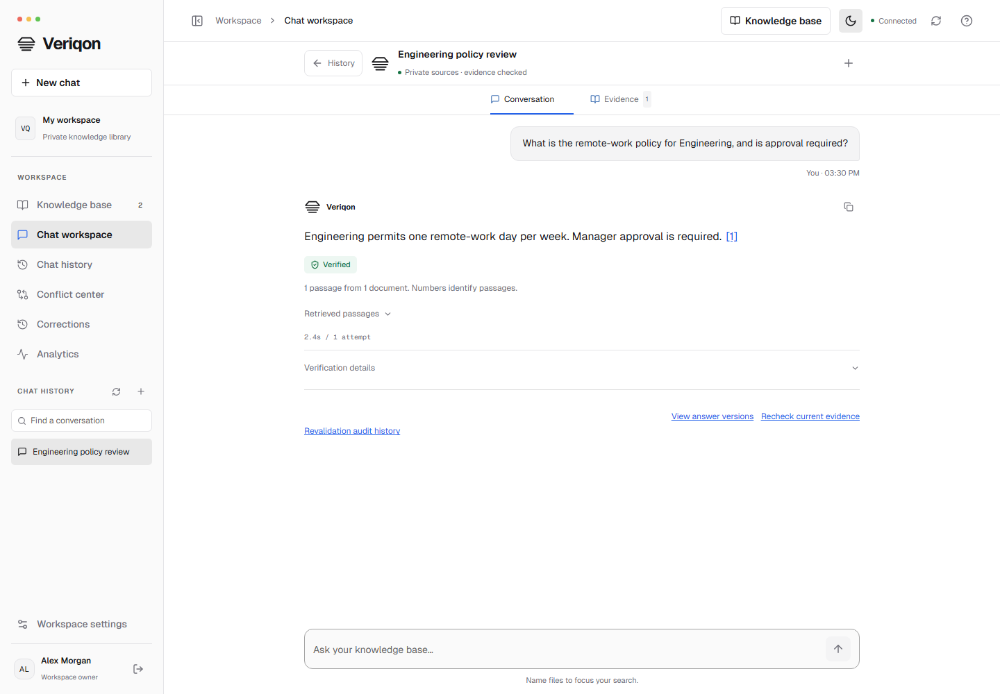
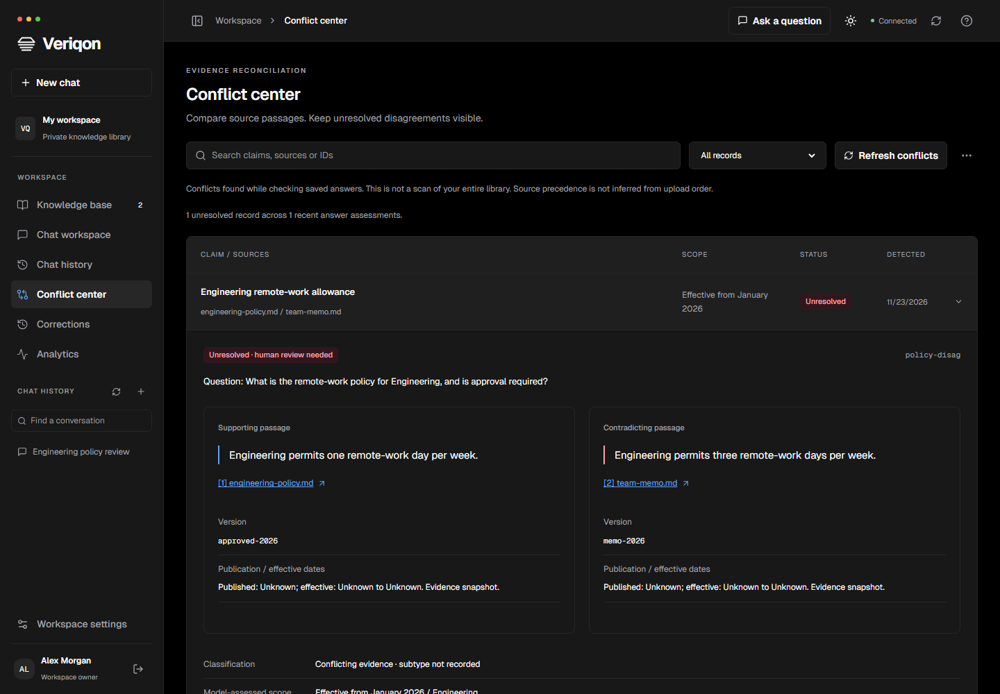
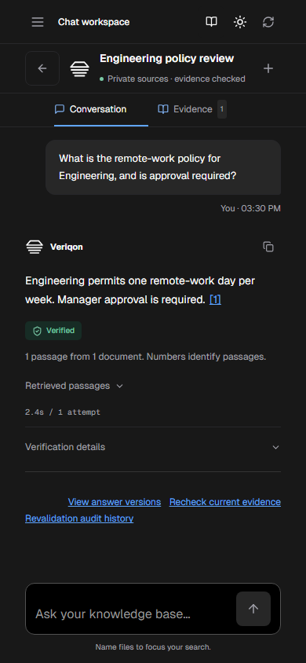

# Veriqon

**Document answers you can inspect. Corrections you can trace.**

A research workspace for evidence-grounded question answering, factual correction and source-conflict review.

[Quick start](#run-locally) | [Architecture](docs/ARCHITECTURE.md) | [Research](research/README.md) | [Deployment](docs/DEPLOYMENT.md) | [Hosted demo](https://veriqon-two.vercel.app)

<picture>
  <source media="(prefers-color-scheme: dark)" srcset="docs/screenshots/chat-dark.png">
  
</picture>

## Why Veriqon

Research papers and policies change. Documents disagree. A plausible answer alone does not show which source supports it, whether that source still applies, or what changed after a correction.

Veriqon keeps that evidence alongside the conversation. It retrieves passages, decomposes an answer into factual claims, checks quoted support and attempts bounded corrections when evidence establishes a replacement. Unresolved claims and source disagreements remain visible. A background worker can reassess saved answers after document updates without overwriting their original versions.

This is a research application with tested local workflows. Model-based verification is an assessment, not a guarantee of truth. See [current capabilities](docs/capabilities.md) and [release readiness](docs/RELEASE_READINESS.md) for the tested boundaries and remaining work.

## What you can do

| Workflow | Behavior |
| --- | --- |
| Build a private library | Upload PDF, DOCX, TXT or Markdown; inspect indexing progress and download originals. |
| Ask with evidence | Hybrid retrieval, named-document scope, passage citations and limited conversation reference context. |
| Inspect factual correction | Atomic claims, exact supporting/contradicting quotes, minimal edits and post-repair verification. |
| Review disagreements | Compare opposing passages, record source decisions and inspect decision history. No inferred authority from upload order. |
| Track knowledge changes | Explicit temporal metadata, archived source versions, queued revalidation and appended answer versions. |
| Recover from interruption | Persistent indexing checkpoints, bounded provider retries, queue reconciliation and source-excerpt fallback. |
| Control your account | Account-isolated data, rotating sessions and single-use recovery codes. |

Conflict review and mobile chat

Screenshots show the current interface using synthetic documents and account data. They illustrate the UI, not a measured accuracy or latency claim. Capture instructions are in [Testing](docs/TESTING.md).

## How correction works

~~~mermaid
flowchart LR
    Q[Question] --> R[Retrieve authorized passages]
    R --> G[Generate draft]
    G --> C[Extract atomic claims]
    C --> V{Check evidence}
    V -->|Supported| A[Cited answer]
    V -->|Insufficient| T[Targeted retrieval]
    T --> V
    V -->|Contradicted| E[Minimal factual edit]
    E --> F{Reverify}
    F -->|Supported substantive change| P[Versioned correction]
    F -->|Unresolved| U[Partial answer or abstention]
    V -->|Conflicting| H[Conflict Center]
~~~

The implementation is **RAC-inspired**, with additional temporal, authorization and reliability safeguards. It is not claimed as a faithful reproduction of the published algorithm. A paraphrase is not a successful factual repair; a repaired claim must survive a fresh evidence assessment. Read the [method and attribution](docs/rac-method.md) and [self-correction design](docs/SELF_CORRECTION.md).

Citation numbers such as [1] and [2] identify retrieved passages. Several passages can come from one document.

## Run locally

Use Docker with Linux containers and Node.js 22.18+ for the setup helper. Live document processing requires an available embedding model and chat model through OpenRouter.

~~~sh
git clone https://github.com/iamrakiib/veriqon.git
cd veriqon
node scripts/init-docker.mjs
~~~

Set OPENROUTER_API_KEY, EMBEDDING_MODEL and LLM_MODEL in the generated private .env.docker. The helper generates independent database, JWT and setup secrets. It never overwrites existing configuration.

~~~sh
docker compose --env-file .env.docker build
docker compose --env-file .env.docker up -d --no-build --wait --wait-timeout 180
~~~

Open **http://localhost:3002**. Create the first owner with SETUP_CODE from .env.docker and save the recovery codes. Later public registration is disabled by default; explicitly enable ALLOW_REGISTRATION if needed.

The stack runs Next.js, NestJS API, a separate background worker, PostgreSQL/pgvector and Redis. Original files, source archives, conversations and corrections are stored in the database. Preserve its volume; deleting volumes deletes data.

[Full installation and backup/restore](docs/INSTALLATION.md) | [Provider configuration](docs/provider-setup.md) | [Troubleshooting](docs/TROUBLESHOOTING.md)

### Try correction without an API key

~~~sh
npm ci
npm run research:demo
~~~

Seven synthetic scenarios exercise the actual orchestration with scripted provider responses: an incorrect number, a correct answer, targeted retrieval, missing evidence, historical scope, a superficial rewrite and a repair introducing a new error. This is a reproducible protocol test, not an independently labeled model benchmark. [Live evaluation and review instructions](research/README.md).

### Develop without Docker

~~~sh
npm ci
npm run setup:local
# Configure the provider in .env, then use two terminals:
npm run start:dev
npm run web:dev
~~~

Open **http://127.0.0.1:3001**. Blank DATABASE_URL and REDIS_URL select SQLite development. SQLite is not the cloud deployment profile. [Environment reference](.env.example).

## Architecture

~~~mermaid
flowchart TD
    Browser --> Web[Next.js]
    Web -->|Same-origin proxy| API[NestJS API]
    API --> PG[(PostgreSQL + pgvector)]
    API --> Redis[(Redis)]
    API --> Models[OpenRouter]
    Worker[Background worker] --> PG
    Worker --> Redis
    Worker --> Models
~~~

PostgreSQL owns application data, embeddings and durable job state. Redis coordinates shared limits, leases and BullMQ delivery. Workers recover from database checkpoints. The semantic answer cache is process-local and checks ownership, source revision and question scope before reuse.

Deployment targets are **Vercel + Render API/worker + Neon + compatible managed Redis**. Background processing needs suitable always-on resources; free-tier hosting is not an availability guarantee. The [cloud guide](docs/DEPLOYMENT.md) distinguishes configuration from executed acceptance tests.

~~~text
apps/web/          Interface and same-origin API proxy
src/auth/          Authentication, sessions and account isolation
src/database/      Persistent data, migrations and version history
src/vector-store/  Embeddings and hybrid passage retrieval
src/rag/           Ingestion, verification, repair and revalidation
src/common/        Provider handling, limits and worker configuration
src/tests/         Backend and infrastructure regression tests
tests/             Browser and full-stack integration tests
research/          Synthetic cases and evaluation documentation
~~~

## Test and evaluate

~~~sh
npm run lint
npm test
npm run test:release
npm run research:demo
npm run web:build
npm run web:check
npx playwright install chromium
npm run test:browser -- --workers=1
npm audit --audit-level=high
~~~

For disposable database and queue integration tests:

~~~sh
docker compose -f compose.test.yaml up -d --wait
npm run test:infra
npm run test:lifecycle
docker compose -f compose.test.yaml down
~~~

CI checks source publication safety, dependencies, backend/frontend behavior and the container installation, correction, restart and restore workflow. Scripted inference keeps deterministic tests reproducible; live-provider observations are recorded separately. [Test methodology and results](docs/TESTING.md) | [Milestone acceptance](docs/IMPLEMENTATION_PLAN.md).

## Scope and limitations

- Model verification and retrieval can fail. Unsupported claims must not be presented as established facts; known live-model failures are tracked in [release readiness](docs/RELEASE_READINESS.md).
- Vector ranking is exact, not ANN. Semantic caching is not shared across API replicas. Capacity claims are limited to measured workloads.
- Conflict records come from assessed answers, not an exhaustive library scan. Explicit metadata and human decisions are required when scope or precedence is unknown.
- Queued uploads allow 10 MB, 500,000 extracted characters and 1,000 passages. Scanned PDFs need external OCR. Provider quota still applies to indexing and answers.
- Accounts use personal libraries. Shared workspace administration, MFA, email verification and email reset delivery are not implemented. Password recovery uses saved one-time codes.
- Independent held-out factuality evaluation, extended mixed-workload soak and complete cloud acceptance remain release work. Local passes do not establish a production SLA.

## Contribute

Browse the [documentation index](docs/README.md) for architecture, operations, evaluation and milestone guides.

Read [CONTRIBUTING.md](CONTRIBUTING.md), [SECURITY.md](SECURITY.md) and the [implementation plan](docs/IMPLEMENTATION_PLAN.md). Submit focused pull requests with reproducible tests. Keep credentials, account records and private documents out of commits and issues.

Original code and synthetic research fixtures are [MIT licensed](LICENSE). Bundled fonts retain their licenses; see [third-party notices](THIRD_PARTY_NOTICES.md).
