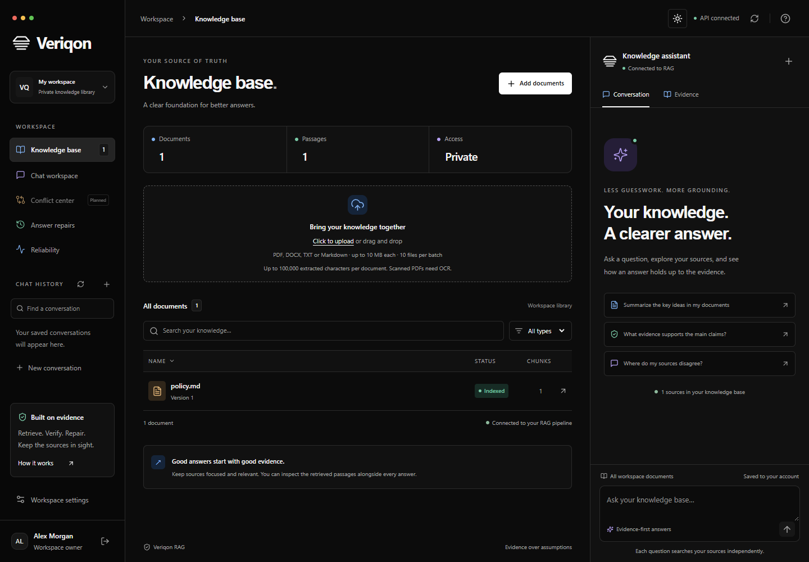

# Veriqon RAG

An evidence-first knowledge workspace built on the existing NestJS Self-Correcting RAG project. The new Next.js interface adapts the supplied reference into a responsive three-panel workspace with document management, an integrated assistant, source previews, answer repair inspection, and observed session metrics.

**Status:** deployable Next.js + NestJS application with PostgreSQL/pgvector persistence, Redis shared request limits, JWT sessions, Docker images, and Vercel/Render configuration. SQLite remains available only for local development. This does not complete the temporal maintenance research target or establish an enterprise uptime/security guarantee. See the [deployment guide](DEPLOYMENT.md) and [production review](docs/production-review.md).

## Docker and cloud deployment

```powershell
node scripts/init-docker.mjs
# Add your provider key/model to the generated private .env.docker.
docker compose --env-file .env.docker up --build -d
```

Open **http://localhost:3002** for the complete Docker stack. PostgreSQL uses a persistent named volume; Redis stores disposable limits/leases. [DEPLOYMENT.md](DEPLOYMENT.md) covers Vercel + Render + Neon + Upstash, existing-data migration, backups, and free-tier limits. These commands do not create cloud accounts or publish the application.

PostgreSQL runs exact pgvector ranking and returns candidate windows. Production parsing uses a separate process with a heap limit and deadline. Non-root Docker images, readiness checks, migrations, a read-only SQLite importer, and GitHub Actions are included. Run `npm run test:infra` against `compose.test.yaml` for real PostgreSQL/Redis integration tests. The instructions below describe the optional SQLite development mode.



The screenshot uses an isolated Playwright fixture. The application itself starts from the actual API document store and contains no seeded document or answer data. [Mobile screenshot](docs/screenshots/workspace-mobile.png).

[Account setup preview](docs/screenshots/auth-desktop-dark.png) / [Light account setup](docs/screenshots/auth-desktop-light.png).

### Appearance

Veriqon uses the supplied reference's stacked-line logo and black-and-white styling. Dark mode is the default. Use the sun/moon button in the top bar to switch between dark and light, or choose **Light / Dark / System** in **Workspace settings → Appearance**. Your choice is saved on this device and applied before the first paint; System mode tracks device theme changes. Controls remain usable if browser storage is blocked, but that session's choice cannot persist.

[Light-mode desktop preview](docs/screenshots/workspace-desktop-light.png) · [Light-mode mobile preview](docs/screenshots/workspace-mobile-light.png).

The workspace fills the browser viewport. Documents and conversation history scroll independently, keeping the chat composer visible on shorter screens. On phones, use **Workspace / Assistant** to switch panels without scrolling down the page. Subtle blue document/upload icons, amber Markdown icons, green status indicators and violet assistant accents complement both themes. [Mobile assistant preview](docs/screenshots/assistant-mobile-dark.png).

## Run locally

Requirements: Node.js 22.18+, npm, and an OpenRouter account for actual ingestion/generation. Microsoft Edge is used by browser tests. No Docker or local language model is required for this increment.

From this directory:

```powershell
npm ci
# Only if .env does not already exist:
Copy-Item .env.example .env
```

Set `JWT_SECRET` to a private random value of at least 32 characters (generate one with `node -e "console.log(require('crypto').randomBytes(48).toString('base64url'))"`). The existing local `.env` already has a generated secret. Never commit this secret.

Configure `OPENROUTER_API_KEY`, `EMBEDDING_MODEL`, and `LLM_MODEL` in `.env`. Choose model IDs available to your provider account. `VERIFIER_MODEL` is optional. Development mode watches .env and restarts the API when configuration changes. Provider secrets remain server-side. Automated tests use stubbed providers and consume no provider credits. The optional evaluation script makes live requests.

Start the API:

```powershell
npm run start:dev
```

In a second terminal, from this same directory:

```powershell
npm run web:dev
```

Open **http://127.0.0.1:3001**. The API defaults to **http://127.0.0.1:3000**. Both bind to loopback by default. Create the first owner account using the one-time code in `data/setup-code.txt`. Choose your own name, email and password (12 or more characters). Existing `data/documents.json` records are imported transactionally into this owner's private library; the original JSON file is kept untouched. Additional accounts start with an empty library. No default account or password is created.

If your existing API uses another port, create `apps/web/.env.local` with `API_ORIGIN=http://127.0.0.1:<port>` and restart the frontend. Keep this a server-side variable; never expose provider secrets through `NEXT_PUBLIC_*`.

### Try the workflow

1. Open Knowledge base and upload a `.pdf`, `.docx`, or UTF-8 `.txt`/`.md` file (10 MB and 100,000 extracted characters maximum; ten files per batch). Scanned PDFs require OCR before upload.
2. Wait for **Indexed**, then click the document to inspect its contents.
3. Ask a question in the assistant. The browser sends it to the actual NestJS query route.
4. Inspect the answer's source chips, Evidence tab and Verification details.
5. If the first draft fails and a repair passes, inspect the original and revised answer in **Answer repairs**.
6. Open **Reliability** for actual store counts and session outcomes. Uninstrumented metrics are labeled accordingly.
7. Click a document, then **Download original** to retrieve its uploaded file. Legacy imports retain extracted text only; re-upload to retain the original.
8. Use **Workspace settings** for appearance, account details and sign-out. Storage is automatic.

SQLite stores users, hashed passwords, sessions, documents, original file bytes and embeddings in `data/veriqon.sqlite`. It uses transactions, foreign keys and WAL. Stop the API before copying the database for a simple consistent local backup; do not copy an actively written database without its WAL or a SQLite backup procedure. Back up `.env` securely, separately from the database.

Questions, answers, citations, provider errors and successful repairs are now saved in SQLite per account. Reopen the latest 100 conversations from **Chat history** in the sidebar (open the navigation menu on mobile). Refreshing, signing out and restarting the API do not delete them. Use **Refresh chat history** to retrieve newer results or changes from another tab. Requests still running or interrupted by a restart are identified explicitly. Chats lost before this feature was added cannot be reconstructed. Each question is independent: previous turns are not supplied to the model. Historical-date filtering is not available yet. Retrieval still scans vectors in memory; SQLite is a single-host foundation, not a distributed vector database.

### Authentication

Access JWTs expire after 15 minutes. Rotating refresh tokens last for a maximum seven-day session. Both are carried in HttpOnly, SameSite=Lax cookies; the browser automatically refreshes expired access tokens. Tokens are not stored in localStorage. Passwords use salted scrypt hashes; only refresh-token hashes are stored. Logout revokes the database session, including unexpired access tokens.

Every document, upload, download and query is scoped to the authenticated account. The owner role owns the imported library; it is not an administrator interface for reading other accounts. Unsafe requests require `X-Veriqon-Request: 1` and validate browser origins. Sign-in limits apply per email and client address. Set `ALLOW_REGISTRATION=false` after creating the required accounts to close public signup. Email addresses are login identifiers; they are not verified.

`APP_ORIGINS` must list the frontend origins. Production requires HTTPS and uses Secure cookies automatically when `NODE_ENV=production`. Keep the API private behind a correctly configured proxy; these local defaults are not a public deployment configuration. Password reset, email verification, MFA and shared workspace invitations are not implemented.

## What works

- Account creation, sign-in, rotating JWT sessions, logout and account-scoped SQLite storage.
- Responsive reference-inspired navigation, document library and assistant; mobile navigation and a chat-focused view.
- Drag-and-drop PDF/DOCX/TXT/Markdown ingestion with server-side parsing, type/size checks, deduplicated upload IDs and per-file processing/error states.
- Document search, file-type filtering, name sorting and full text previews.
- Real typed API integration, connection status, refresh, timeouts and actionable errors.
- New session conversations, query progress, source passages and verification details.
- Structured sentence assessment with evidence-index validation, one repair attempt and abstention on failed re-verification.
- Original/revised repair comparisons and observed session latency/outcome counts.
- Keyboard focus styles, labeled controls, a skip link, reduced-motion styling, and Radix dialogs with focus management.
- Server-side DTO validation, bounded field lengths/batches, finite provider timeouts and sanitized query errors.
- Failed document replacement preserves the original. Bulk ingestion reports actual successes/failures.
- NestJS dependency upgrade and a patched transitive Multer override; lockfile and CI checks included.

Model-supported does **not** mean independently verified truth. Semantic similarity is used for retrieval, not factual confidence. The verifier still requires evaluation against independently labeled evidence.

## Architecture

```text
sc-rag/
  apps/web/                 Next.js, React, Tailwind, Radix Dialog, Lucide
    src/app/                App shell, metadata and responsive styles
    src/components/         Workspace, library, assistant and dialogs
    src/lib/api.ts          Typed client for the existing NestJS endpoints
  src/
    rag/                    Controller, structured verification and bounded repair
    vector-store/           OpenRouter embeddings, owner-scoped retrieval and query cache
    auth/                   JWT sessions, cookies, password hashing and guards
    database/               SQLite schema, transactions and legacy migration
    common/                 Chunking and similarity helpers
    tests/                  Deterministic unit and HTTP integration tests
  tests/browser/            Desktop/mobile interaction tests
  docs/                     Audit, migration roadmap and UI screenshots
  .github/workflows/ci.yml  Lint, tests, builds and dependency audit
```

The API stays in `src/` to preserve existing run commands and module boundaries. The npm workspace provides a migration seam without moving working backend code solely to rename directories. PostgreSQL/pgvector, shared contracts and worker services are the next architectural step.

```text
Browser → Next /api/rag/* proxy → NestJS /rag/*
  → embed question → retrieve chunks → generate draft
  → structured model assessment → optional repair + reassessment
  → supported / repaired answer, or abstention
```

## API compatibility

| Method | Route | Behavior |
| --- | --- | --- |
| GET | `/rag/health` | API liveness, provider-key presence and capability flags; does not test the provider |
| POST | `/rag/add` | `{ id, text, source?, page?, version? }`; chunks and indexes text |
| POST | `/rag/bulk-add` | `{ documents: [...] }`; up to 20 items; returns actual `count`, `success`, `errors` |
| POST | `/rag/query` | `{ query, conversationId?, messageId? }`; maximum 4,000 characters; optional UUIDs group messages and deduplicate retries |
| GET | `/rag/conversations` | Latest 100 conversations with saved messages, scoped to the signed-in account |
| GET | `/rag/docs` | Actual document records, text and chunk counts |
| POST | `/rag/upload` | Multipart `file`; parse PDF/DOCX/TXT/MD, embed and persist |
| DELETE | `/rag/docs/:id` | Remove an owned document and original file; historical chat excerpts remain |
| GET | `/rag/docs/:id/file` | Download the authenticated account's original upload |
| GET | `/auth/status` | Public setup and registration availability |
| POST | `/auth/register` | `{ email, name, password, setupCode? }`; owner setup or regular signup |
| POST | `/auth/login` | `{ email, password }`; issue HttpOnly session cookies |
| GET | `/auth/me` | Current authenticated account |
| POST | `/auth/refresh` | Rotate refresh cookie and renew access JWT |
| POST | `/auth/logout` | Revoke session and clear cookies |

`/rag/save` and `/rag/load` were removed: each write is committed automatically to SQLite. All RAG routes except health require authentication. Direct clients must retain login cookies and include `X-Veriqon-Request: 1` on POST and DELETE requests.

Requests are validated and unknown fields rejected. JSON request bodies are bounded to 750 KB; documents are bounded to 100,000 characters by the API, with a 10 MB original-file limit. Large bulk requests must be split. Direct `/rag` routes remain available, and the frontend proxy uses `/api/rag`.

The query response retains `draft`, `factCheck`, and `citations`, and adds `status`, `attempts`, `durationMs`, and nullable `correction`. Citations now include stable document IDs and full retrieved passages. `factCheck.claims` contains sentence assessments and evidence indexes. The old similarity-derived `confidence` is intentionally removed.

`status` is `supported`, `repaired`, or `abstained`. Verification is fail-closed for malformed JSON, incomplete assessments or invalid evidence references. If a second assessment fails, `draft` contains an abstention, not the unsupported answer.

## Validation

```powershell
npm run lint
npm test
npm run web:check
npm run web:build
npm run test:browser
npm audit
```

If Edge is unavailable, install the Playwright channel using `npx playwright install msedge`. Browser tests start their own Next dev server on port 3001 and mock API responses at the network boundary. Backend tests use an actual local Nest HTTP server with deterministic provider stubs. Neither suite spends provider credits or writes user documents.

Latest validation: 29 backend tests, 5 real PostgreSQL/Redis integration tests, and 29 desktop/mobile browser tests passed; one duplicate mobile invocation of the multi-viewport test is intentionally skipped. Lint, TypeScript checks, optimized frontend/Docker builds, and the running Docker frontend/API health checks also passed. Live provider quality and public-host deployment have not been validated.

The deterministic suites cover verification and repair, parser failures, upload deduplication, SQLite persistence, first-owner migration, cross-account isolation, private downloads, conversation persistence and isolation, password hashing, JWT expiry, refresh rotation, logout revocation, CSRF checks, and cache invalidation. Desktop/mobile browser tests cover uploads, chat, citations, account forms, session expiry, themes and viewport fit. Screenshots use isolated synthetic fixtures, never user documents.

`npm run evaluate` is a provider-backed smoke script. Set `EVAL_EMAIL` and `EVAL_PASSWORD` for a test account with indexed documents. It signs in before querying and consumes provider quota. Its abstention count is not a benchmark, hallucination rate or factual accuracy metric. The manual `node test-api.js` script uses the same credentials and adds a synthetic document to that account.

For a local optimized frontend, run `npm run web:build` then `npm run web:start`, with the API running in another terminal. Set frontend `API_ORIGIN` before building if changing the backend port.

## Remaining work before enterprise deployment

Not implemented: shared workspaces and invitations, email verification/password recovery/MFA, PostgreSQL/pgvector, immutable versions, effective-time retrieval, deterministic authority rules, continuous revalidation, durable ingestion workers, operational monitoring, deployment backups and independent research benchmarks.

The conflict center explicitly reports that its backend feature is not connected. Unknown metadata is not invented. Current authorization isolates personal libraries; public deployment still needs capacity limits, operational hardening and a reviewed hosting configuration.

Full details, changed file groups and staged next steps: [implementation audit](docs/implementation-audit.md).

### Upload and chat troubleshooting

- The file picker accepts PDF, DOCX, TXT and Markdown. Legacy `.doc` files must be converted to `.docx`. Image-only PDFs need OCR; encrypted or malformed documents return a readable error.
- Uploads allow 10 MB per file, 100,000 extracted characters, and ten files per batch. Excess batch files are reported individually rather than silently ignored.
- Development mode reloads `.env`; production needs a server restart. `OPENROUTER_BASE_URL` is respected by both embeddings and chat. The API key is never sent to the browser.
- Errors distinguish invalid credentials, insufficient credits, unavailable models, rate limits, and timeouts. Short rate-limit cooldowns and temporary upstream failures receive one retry; a query has a 150-second overall deadline. The browser and proxy allow 180 seconds.
- A free generation model can work while a separate free verifier is rate-limited. Set `VERIFIER_MODEL` to an available model (or omit it to use `LLM_MODEL`). Verification is still required before returning supported answers.
- Indexed documents and original files are committed transactionally to SQLite before success is returned. `DATABASE_PATH` can override the database location; `DOCUMENT_STORE_PATH` identifies only the legacy JSON import. Changing `EMBEDDING_MODEL` requires re-uploading existing documents.

### Answer context and abstention reasons

Retrieval expands each selected chunk with up to two neighbors on either side, removes overlapping text, avoids reusing chunks, and bounds the combined evidence at 18,000 characters. Citations identify the included chunk range. Existing documents do not need re-indexing for this change.

An abstained query includes `reason`: `no_documents`, `insufficient_context`, or `verification_failed`. Empty or output-limited model completions are reported as provider errors rather than as missing document information. Answers may explain the supported parts of a question while identifying missing details; the evidence verification step still applies. Repair requests receive the failed assessment.

Verification uses numbered sentence IDs instead of requiring the model to repeat each sentence. IDs, coverage, boolean verdicts and evidence indexes are validated before any answer passes. OpenRouter requests use a low reasoning effort and explicit output budgets to leave room for the answer and assessment; see the [provider reasoning controls](https://openrouter.ai/docs/guides/best-practices/reasoning-tokens).

### Why answers can be slow

A new question normally needs an embedding request, answer generation and evidence verification, with another generation/verification pair if a repair is needed. Provider queues, free-model quotas and response length add latency. Bounded retries prevent indefinite waiting. Query embeddings are cached for ten minutes; successful repeated answers are cached for five minutes per account and document revision. Uploading or replacing a document invalidates its account's answer cache. Cached answers are labeled in the UI. These caches are bounded, kept in process memory and cleared on restart; they do not bypass verification for new answers.

A missing answer can mean no documents, insufficient retrieved passages, or failed verification; the UI distinguishes them. Retrieval includes neighboring chunks and deduplicates overlaps. Empty or truncated provider output is an error, not evidence that the uploaded paper lacks information. Live provider accuracy and latency still need measurement; quota exhaustion cannot be fixed by switching to another model using the same account-wide allowance.

### Review hardening

Query clients can provide a stable UUID `messageId` with `conversationId` to replay a completed request without another model call. Reusing the ID for a different question, or replaying a pending/failed request, returns 409. An intentional retry of a failed question uses a new ID. The UI supplies message IDs automatically.

Expensive API operations are limited to one active operation per account and four in this API process, with 20 operations per account per minute. Overload returns 429 instead of an unbounded queue. Identical uploads reuse existing embeddings when their content, metadata and embedding model match. These local limits do not implement distributed queues, token budgets or storage quotas.

Saved answers carry the library revision used for generation. A changed library displays a warning and invalidates the answer cache; historical citation text is retained. This is conservative change detection, not continuous revalidation or temporal correctness. Deleting a document removes its original and search chunks, not its excerpts in existing conversations.

Chat history now has title search; the assistant supports copy, keyboard evidence tabs, elapsed-time feedback and distinct abstention reasons. Answer repairs includes withheld attempts as well as accepted revisions. Conflict center remains marked Planned. See `docs/production-review.md` for the recruiter assessment, full target gaps and research evaluation protocol.
